<a href="https://github.com/icoretech#gh-light-mode-only">
<picture>
  <source media="(max-width: 1079px)" srcset="assets/banner-light-mobile.svg">
  
</picture>
</a>

<a href="https://github.com/icoretech#gh-dark-mode-only">
<picture>
  <source media="(max-width: 1079px)" srcset="assets/banner-dark-mobile.svg">
  
</picture>
</a>

  <a href="https://icorete.ch"><b>icorete.ch</b></a> &nbsp;·&nbsp;
  <a href="https://audiobox.fm"><b>AudioBox</b></a> &nbsp;·&nbsp;
  <a href="https://github.com/icoretech/airbroke"><b>Airbroke</b></a> &nbsp;·&nbsp;
  <a href="https://codex-pooler.com"><b>Codex Pooler</b></a> &nbsp;·&nbsp;
  <a href="https://x.com/icoretech_inc"><b>X</b></a> &nbsp;·&nbsp;
  <a href="mailto:public@icorete.ch"><b>public@icorete.ch</b></a>

 

### What we make

- **[AudioBox](https://audiobox.fm)** — The definitive home for your media library, in the cloud.
- **[Airbroke](https://github.com/icoretech/airbroke)** — Self-hosted, Sentry-compatible error catcher.
- **[Codex Pooler](https://codex-pooler.com)** — The self-hosted Codex gateway for teams and agents.

### Open source

| Project | What it is | Stars | Latest |
| :--- | :--- | ---: | :--- |
| [codex-pooler](https://github.com/icoretech/codex-pooler) | The self-hosted Codex gateway for teams, agents and you. | 240 | v0.14.7 |
| [airbroke](https://github.com/icoretech/airbroke) | Open-source, Sentry-compatible error catcher. Self-hosted, Postgres-backed. | 220 | v1.4.10 |
| [helm](https://github.com/icoretech/helm) | The iCoreTech Helm charts: opinionated Kubernetes deployments. | 18 | — |
| [wootty](https://github.com/icoretech/wootty) | A browser terminal for shells, coding agents and long-running work. | 31 | v0.3.1 |
| [warden-mcp](https://github.com/icoretech/warden-mcp) | Vaultwarden / Bitwarden MCP server for credential-aware AI agents. | 27 | v0.2.70 |
| [spotify-client](https://github.com/icoretech/spotify-client) | A Ruby client for the Spotify Web API. Small, complete, tested. | 79 | v1.1.2 |
| [mattermost-timeline](https://github.com/icoretech/mattermost-timeline) | Webhook-powered event timeline for Mattermost: deploys, alerts, incidents. | 11 | v2.2.1 |
| [mattermost-voice-messages](https://github.com/icoretech/mattermost-voice-messages) | WhatsApp-style voice messages for Mattermost channels and threads. | 10 | v0.3.5 |

Stars and releases are refreshed daily from public GitHub data · Updated 2026-11-11
